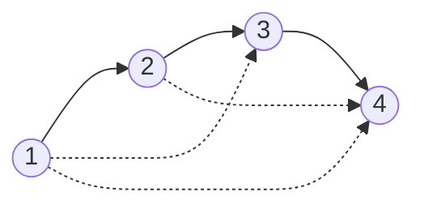

<div align="center">

# 🔗 Relation Closure Engine

### *Relations stay abstract until you store one.*

An engine that represents relations as **boolean matrices** and computes their
**reflexive**, **symmetric** and **transitive** closures.


[Overview](#-overview) •
[The Math](#-the-math) •
[Quick Start](#-quick-start) •
[Demo](#-live-demo-output) •
[How It Works](#-how-it-works) •
[Team](#-team)

</div>

---

## 📖 Overview

A binary relation **R** on a set `{1, 2, …, n}` is just a set of ordered pairs.
This project stores that set as an **n × n matrix of 0s and 1s**, where
`M[i][j] = 1` means *i is related to j*. Once a relation lives in a matrix,
its closures become simple, mechanical matrix operations.

| ✨ Feature | Description |
|---|---|
| 🧮 **Matrix representation** | Any relation on up to 10 elements, entered as pairs |
| 🔍 **Property checker** | Tests reflexive, symmetric, transitive and equivalence |
| ➕ **Three closures** | Reflexive, symmetric and transitive |
| 🪜 **Warshall trace** | Prints the matrix after every step *k* |
| 🎯 **Equivalence builder** | Finds the smallest equivalence relation containing R |
| 🎬 **Demo mode** | `--demo` runs a built-in example instantly |

---

## 🧠 The Math

| Closure | Formula | Matrix operation | Complexity |
|:---|:---:|:---|:---:|
| **Reflexive** | R ∪ Δ | set every diagonal entry to 1 | `O(n)` |
| **Symmetric** | R ∪ R⁻¹ | M ∨ Mᵀ | `O(n²)` |
| **Transitive** | R ∪ R² ∪ … ∪ Rⁿ | Warshall: `m[i][j] ∨= m[i][k] ∧ m[k][j]` | `O(n³)` |

> 💡 **Key idea:** the closure of a relation is the *smallest* relation that
> contains R and has the property.

> 🏆 **Bonus:** `t( s( r(R) ) )` is the smallest **equivalence relation**
> containing R. The program computes it at the end of every run.

---

## 🚀 Quick Start

```bash
# 1. Clone
git clone https://github.com/rtroza274-afk/Relation-closure-engine.git
cd Relation-closure-engine

# 2. Compile
gcc -Wall -Wextra -o relations main.c

# 3. Run
./relations --demo     # built-in example: 1 → 2 → 3 → 4
./relations            # enter your own relation
```

<details>
<summary><b>📥 Entering your own relation</b></summary>

<br>

```text
Size of set n (1-10): 3
Enter pairs 'a b' meaning a R b. Enter 0 0 to stop.
1 2
2 3
0 0
```

Elements are numbered from 1. Enter `0 0` to finish.

</details>

---

## 🎬 Live Demo Output

Example relation: **R = { (1,2), (2,3), (3,4) }**


**Transitive closure** adds the shortcuts (dashed):



**Warshall's algorithm, step by step**

| After step | Paths through … allowed | New pairs added |
|:---:|:---:|:---|
| k = 1 | {1} | none |
| k = 2 | {1, 2} | (1,3) |
| k = 3 | {1, 2, 3} | (1,4), (2,4) |
| k = 4 | {1, 2, 3, 4} | none |

<details>
<summary><b>🖥️ Show the matrices</b></summary>

<br>

```text
Matrix M_R:                 Final transitive closure:
     1  2  3  4                  1  2  3  4
    ------------                ------------
 1 | 0  1  0  0              1 | 0  1  1  1
 2 | 0  0  1  0              2 | 0  0  1  1
 3 | 0  0  0  1              3 | 0  0  0  1
 4 | 0  0  0  0              4 | 0  0  0  0
```

</details>

---

## ⚙️ How It Works

```text
        ┌──────────┐     ┌─────────────┐     ┌───────────────┐     ┌──────────┐
        │  Input   │ ──▶ │   Matrix    │ ──▶ │   Closure     │ ──▶ │  Output  │
        │  pairs   │     │ Relation{n, │     │   functions   │     │ pairs +  │
        │  (a, b)  │     │   m[][]}    │     │               │     │ matrices │
        └──────────┘     └─────────────┘     └───────────────┘     └──────────┘
```

**Warshall's algorithm**

```c
for (k = 0; k < n; k++)
    for (i = 0; i < n; i++)
        for (j = 0; j < n; j++)
            m[i][j] = m[i][j] || (m[i][k] && m[k][j]);
```

> After step *k*, entry `(i, j)` is 1 exactly when a path from *i* to *j* exists
> using only intermediate nodes `{1..k}`. The loop over **k must be outermost**.

**Main functions**

| Function | Purpose |
|---|---|
| `reflexive_closure()` | adds every `(i, i)` |
| `symmetric_closure()` | adds `(j, i)` for every `(i, j)` |
| `transitive_closure()` | Warshall's algorithm, with optional step trace |
| `is_reflexive()` / `is_symmetric()` / `is_transitive()` | property tests |
| `print_matrix()` / `print_pairs()` | display in matrix and set form |

---

## 🗂️ Project Structure

```text
Relation-closure-engine/
├── main.c        # the engine and demo
├── README.md     # you are here
├── .gitignore
└── docs/         # slides, report and screenshots
```

---

## 🔭 Future Work

- [ ] Read relations from a file
- [ ] Export graphs as images (Graphviz)
- [ ] Support larger sets with dynamic memory
- [ ] Compute equivalence classes and partitions

---

## 👥 Team

<div align="center">

**Group 9 · CSE 173 · North South University**

| 👩‍💻 Name | 🆔 Student ID |
|:---|:---:|
| **Tilika Biswas** | 2621946042 |
| **Raiana Tabassum Roza** | 2625101642 |
| **Fatima Jannat** | 2613331642 |
| **Alima Binta Ahamed** | 2622652042 |

</div>

---

<div align="center">

⭐ *If this project helped you understand closures, give it a star!* ⭐

</div>
