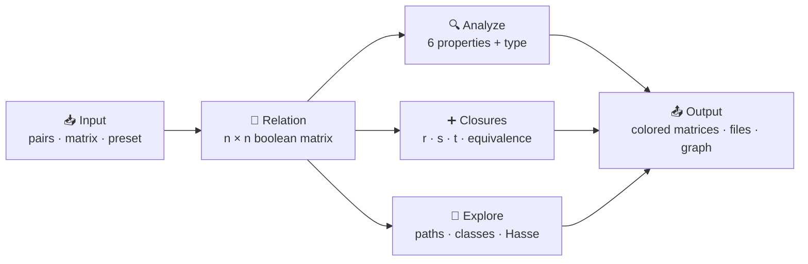
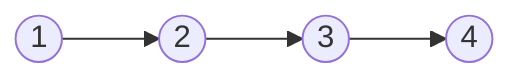
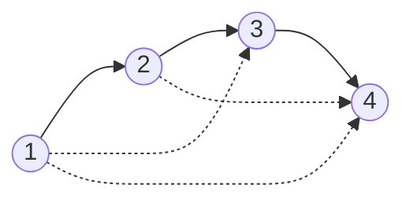

<div align="center">

# 🔗 Relation Lab

### *Relations stay abstract until you store one.*

An **interactive engine** that represents relations as boolean matrices, then
analyzes, classifies and closes them: reflexive, symmetric and transitive.


[Overview](#-overview) •
[Features](#-features) •
[Quick Start](#-quick-start) •
[Menu](#-the-menu) •
[The Math](#-the-math) •
[Example](#-worked-example) •
[Team](#-team)

</div>

---

## 📖 Overview

A binary relation **R** on a set `A = {1, 2, …, n}` is a set of ordered pairs.
**Relation Lab** stores it as an **n × n matrix of 0s and 1s**, where
`M[i][j] = 1` means *i is related to j*. Once a relation lives in a matrix,
every property and every closure becomes a clear, mechanical operation.

This is not just a calculator. It **explains** its answers: when a property
fails it shows the exact pair that breaks it, and when a closure grows it
highlights every new pair.



---

## ✨ Features

| | Feature | Details |
|---|---|---|
| 🎛️ | **Interactive menu** | 13 options, input validation, no crashes on bad input |
| 🔍 | **Six properties** | Reflexive, irreflexive, symmetric, antisymmetric, asymmetric, transitive |
| 💡 | **Counter-examples** | A failed property names the pair that breaks it |
| 🏷️ | **Classification** | Preorder, equivalence relation, partial order, strict partial order, total order |
| ➕ | **Closures** | Reflexive, symmetric, transitive and equivalence closure |
| 🪜 | **Warshall trace** | Matrix after every step *k*, with new pairs in **green**; optional step-by-step mode |
| 🔄 | **Operations** | Inverse `R⁻¹`, complement, powers `Rᵏ` |
| 🧭 | **Paths** | Shortest path between two elements and an all-pairs distance table |
| 🧩 | **Structure tools** | Equivalence classes, Hasse diagram covering pairs, minimal and maximal elements |
| 📦 | **Presets** | Chain, cycle, congruence mod 3, divisibility, ≤, random |
| 💾 | **Files** | Save and load a relation; export a **Graphviz** graph |
| 📖 | **Glossary** | Every term defined inside the program |

---

## 🚀 Quick Start

```bash
# 1. Clone
git clone https://github.com/rtroza274-afk/Relation-closure-engine.git
cd Relation-closure-engine

# 2. Compile
gcc -Wall -Wextra -o relations main.c

# 3. Run
./relations
```

> 🎨 If your terminal shows odd characters instead of colors, run
> `./relations --no-color`.

**Requirements:** a C compiler (`gcc`) and a terminal. Graphviz is optional,
only needed to turn the exported graph into an image.

---

## 🎛️ The Menu

```text
   1) Enter relation as pairs      8) Paths and distances
   2) Enter relation as matrix     9) Equivalence classes
   3) Load a preset example       10) Hasse diagram / order tools
   4) Show current relation       11) Save / load file
   5) Analyze properties          12) Export Graphviz graph
   6) Closures (Warshall)         13) Glossary of terms
   7) Inverse, complement, power   0) Exit
```

<details>
<summary><b>📥 Entering your own relation</b></summary>

<br>

**As pairs** (menu 1). Elements are numbered from 1, and `0` finishes:

```text
Size of the set n (1-12): 3
pair> 1 2
pair> 2 3
pair> 0
```

**As a matrix** (menu 2). One row per line, with 0 or 1 values:

```text
row  1> 0 1 0
row  2> 0 0 1
row  3> 0 0 0
```

The set can have up to **12 elements**.

</details>

<details>
<summary><b>📦 Built-in presets</b></summary>

<br>

| # | Preset | Type |
|:-:|---|---|
| 1 | Chain `1→2→3→4` | none, great for closures |
| 2 | Cycle `1→2→3→1` | none, fills completely when closed |
| 3 | Congruence `a ≡ b (mod 3)` on `{1..6}` | **equivalence relation** |
| 4 | Divisibility `a \| b` on `{1..6}` | **partial order** |
| 5 | Less-or-equal `a ≤ b` on `{1..5}` | **total order** |
| 6 | Random, 5 elements | whatever you get |

</details>

---

## 🧠 The Math

### The three closures

| Closure | Formula | Matrix operation | Complexity |
|:---|:---:|:---|:---:|
| **Reflexive** `r(R)` | R ∪ Δ | set every diagonal entry to 1 | `O(n)` |
| **Symmetric** `s(R)` | R ∪ R⁻¹ | M ∨ Mᵀ | `O(n²)` |
| **Transitive** `t(R)` | R ∪ R² ∪ … ∪ Rⁿ | Warshall: `m[i][j] ∨= m[i][k] ∧ m[k][j]` | `O(n³)` |

> 💡 The closure of a relation is the **smallest** relation that contains R
> and has the property.

> 🏆 `t( s( r(R) ) )` is the **smallest equivalence relation** containing R
> (menu 6, option 5).

### Warshall's algorithm

```c
for (k = 0; k < n; k++)
    for (i = 0; i < n; i++)
        for (j = 0; j < n; j++)
            m[i][j] = m[i][j] || (m[i][k] && m[k][j]);
```

After step *k*, entry `(i, j)` is 1 exactly when a path from *i* to *j* exists
using only intermediate nodes `{1..k}`. The loop over **k must be outermost**.

### Property definitions

| Property | Meaning |
|:---|:---|
| **Reflexive** | every `(a,a)` is in R |
| **Irreflexive** | no `(a,a)` is in R |
| **Symmetric** | `(a,b)` in R forces `(b,a)` in R |
| **Antisymmetric** | `(a,b)` and `(b,a)` in R only when `a = b` |
| **Asymmetric** | `(a,b)` in R forbids `(b,a)` in R |
| **Transitive** | `(a,b)` and `(b,c)` in R force `(a,c)` in R |

### How the types are recognized

| Type | Needs |
|:---|:---|
| **Preorder** | reflexive + transitive |
| **Equivalence relation** | reflexive + symmetric + transitive |
| **Partial order (poset)** | reflexive + antisymmetric + transitive |
| **Strict partial order** | irreflexive + transitive |
| **Total order** | partial order + every two elements comparable |

---

## 🎬 Worked Example

**R = { (1,2), (2,3), (3,4) }**



**Transitive closure** adds the shortcuts (dashed):



| After step | Paths through … allowed | New pairs added |
|:---:|:---:|:---|
| k = 1 | {1} | none |
| k = 2 | {1, 2} | (1,3) |
| k = 3 | {1, 2, 3} | (1,4), (2,4) |
| k = 4 | {1, 2, 3, 4} | none |

<details>
<summary><b>🖥️ Sample property analysis (divisibility on {1..6})</b></summary>

<br>

```text
=== PROPERTY ANALYSIS ===
  Reflexive      [YES]  every (a,a) is present
  Irreflexive    [NO ]  (1,1) is present
  Symmetric      [NO ]  (1,2) is in R but (2,1) is not
  Antisymmetric  [YES]  no two different elements point to each other
  Asymmetric     [NO ]  (1,1) and (1,1) are both in R
  Transitive     [YES]  every 2-step path has a shortcut

  Classification
   * Preorder
   * Partial order (poset)
```

Hasse diagram covering pairs: `1<2, 1<3, 1<5, 2<4, 2<6, 3<6`
Minimal element: `1` · Maximal elements: `4, 5, 6`

</details>

<details>
<summary><b>🧩 Sample equivalence classes (congruence mod 3 on {1..6})</b></summary>

<br>

```text
   [1] = { 1, 4 }
   [2] = { 2, 5 }
   [3] = { 3, 6 }
  3 equivalence classes.
```

</details>

<details>
<summary><b>🧭 Sample distance table (cycle 1→2→3→1)</b></summary>

<br>

```text
      1  2  3
      ---------
   1 | 3  1  2
   2 | 2  3  1
   3 | 1  2  3
```

A number *d* at `(i, j)` means that pair first appears in `R^d`.

</details>

---

## 🖼️ Graphviz Export

Menu **12** writes `relation.dot`. Solid arrows are the original relation and
**dashed red arrows** are the pairs added by the transitive closure.

```bash
sudo apt install graphviz
dot -Tpng relation.dot -o relation.png
```

---

## 🗂️ Project Structure

```text
Relation-closure-engine/
├── main.c          # the whole engine and interactive menu
├── README.md       # you are here
├── .gitignore
├── docs/           # slides, report and screenshots
├── relation.txt    # created by menu 11 (saved relation)
└── relation.dot    # created by menu 12 (Graphviz graph)
```

<details>
<summary><b>🧱 Main functions</b></summary>

<br>

| Function | Purpose |
|---|---|
| `reflexive_closure()` / `symmetric_closure()` | build the first two closures |
| `transitive_closure()` | Warshall's algorithm with optional trace |
| `equivalence_closure()` | `t(s(r(R)))` |
| `is_reflexive()` … `is_transitive()` | property tests that also return a counter-example |
| `inverse()` / `complement()` / `compose()` | relation operations |
| `bfs()` / `find_path()` / `distance_matrix()` | paths and distances |
| `equivalence_classes()` / `hasse()` | structure tools |
| `export_dot()` | Graphviz output |

</details>

---

## 🔭 Future Work

- [ ] Support larger sets with dynamic memory
- [ ] Combine two relations (union, intersection, composition `R ∘ S`)
- [ ] Draw the Hasse diagram in the Graphviz export
- [ ] Optional GUI

---

## 👥 Team

<div align="center">

**Group 9 · CSE 173 · North South University**

| 👩‍💻 Name | 🆔 Student ID |
|:---|:---:|
| **Tilika Biswas** | 2621946042 |
| **Raiana Tabassum Roza** | 2625101642 |
| **Fatima Jannat** | 2613331642 |
| **Alima Binta Ahamed** | 2622652042 |

</div>

---

<div align="center">

⭐ *If this project helped you understand closures, give it a star!* ⭐

</div>
